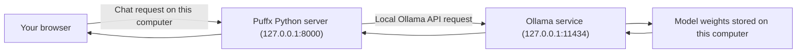

# Puffx Ofline GPT

**Private AI chat running locally on your computer.**

**Powered by Puffx Host · Made with Nitin Mehta.**


**[🌐 Open the Live UI Demo](https://puffxhost.github.io/Puffx-Offline-GPT/)** · Visual preview only; run the app with Ollama locally for real AI chat.

Puffx Ofline GPT is a ChatGPT-inspired interface for chatting with an AI model running on your own computer through [Ollama](https://ollama.com/). It is an independent project and is not affiliated with OpenAI. The name describes the interface; this project does **not** contain ChatGPT, OpenAI models, or model weights.

## What this repository is for

This repository gives you a simple browser-based chat screen and a small local Python server that passes your conversation to Ollama. Install Ollama, download a supported model once, start the app, and chat in your browser. You do not need an OpenAI account, cloud API key, subscription, Node.js, or Python packages. Developer-related questions can also use a bundled professional profile plus refreshed text from the linked public profile pages.

Use it for local text conversations such as asking questions, explaining topics, brainstorming, drafting text, or getting coding help. The exact quality and speed depend on the model you choose and your computer. The default model is `qwen2.5:3b`; this is a compact text model, not a copy of ChatGPT. It does not provide general web search, image generation, or file attachments. For developer-related questions only, it refreshes a small allowlist of public profile pages when online; this is retrieval context, not model training.

### How a message travels



The browser saves chat history in that browser profile's local storage. The model is downloaded separately by Ollama. By default, the Python server accepts connections only from this computer; the app is not a hosted website for other devices.

### What is in the repository

| File or folder | Purpose |
| --- | --- |
| `server.py` | Serves the web interface, forwards chat requests to Ollama, and retrieves developer-profile context for related questions. Uses only Python's standard library. |
| `developer_profile.md` | Curated professional profile used as local fallback knowledge. |
| `static/index.html` | Chat page layout and branding. |
| `static/style.css` | Responsive dark/light interface and motion effects. |
| `static/app.js` | Chat history, status display, theme, and browser interactions. |
| `START_OFFLINEGPT.bat` | Optional Windows launcher that starts the server and opens the local page. |
| `assets/` | Animated README preview graphics. |
| `LICENSE` | MIT license for this project's code. |

## Features

- ChatGPT-inspired dark interface with light theme, prompt suggestions, and a conversation sidebar.
- Runs inference through an Ollama model on your computer; no cloud AI API key is needed.
- Keeps conversation history in your browser's local storage.
- Includes a compact developer/founder profile with an expandable story and public profile links.
- Lets you set the workspace label manually or by chat command; the label is saved only in this browser.
- Copy any assistant response with one click; copied text remains on your device.
- Python web server uses only Python's standard library; no Python packages or build tools are required.
- Binds to `127.0.0.1` by default, so the web app is only available on the same computer.
- Animated interface preview above. The app respects the operating system's reduced-motion preference.
- Uses curated developer-profile facts and refreshes the linked public profile pages on developer-related questions (six-hour in-memory cache).

## Requirements

- Windows 10 or newer, macOS, or a supported Linux distribution.
- Python 3.11 or newer.
- Ollama installed and running.
- Internet access for initial software/model downloads and optional live profile refresh. After downloading the model, core chat works offline; developer questions then use the bundled profile.
- Free disk space for the selected model. The default `qwen2.5:3b` model download is about 1.9 GB. You do not need a GPU, but a compatible GPU can improve speed; CPU-only generation may be slower. Model memory needs and speed depend on your machine.

Model weights are downloaded separately by Ollama. Pick a model that fits your storage and computer; the download size below is **disk space**, not the total RAM needed while it is running. Smaller models are easier to run but can give weaker answers; larger ones need more memory and may be slower. Check each publisher's license before redistributing model weights.

## Model choices and suggestions

**Default and recommended for most users: `qwen2.5:3b` (~1.9 GB).** It is the project's default and a middle ground between download size and capability. If your computer has limited storage or memory, start with **`qwen2.5:0.5b` (~398 MB)** instead; it is smaller but may give simpler answers. Puffx can also use any text model downloaded in Ollama. The model dropdown marks the current default with **(default)** and shows the on-disk size Ollama reports for each installed model. These are example choices from the [Ollama model library](https://ollama.com/library):

| Model tag | Approx. download | Suggested use |
| --- | ---: | --- |
| `qwen2.5:0.5b` | 398 MB | Smallest Qwen option for low-storage or low-memory computers; simpler answers. |
| `gemma3:1b` | 806 MB | Small text model when you want an alternative to Qwen. |
| `qwen2.5:1.5b` | 986 MB | A small step up from 0.5B while keeping download size modest. |
| `llama3.2:1b` | 1.3 GB | Compact multilingual model; the model publisher lists Hindi among its supported languages. |
| `qwen2.5:3b` | 1.9 GB | **Default and recommended for most users**; balances download size and capability. |
| `qwen2.5:7b` | 4.7 GB | Larger Qwen option; requires more storage and computer memory. |

Sizes are approximate and can change when Ollama updates model builds or quantizations. See the [Qwen 2.5](https://ollama.com/library/qwen2.5), [Gemma 3](https://ollama.com/library/gemma3), and [Llama 3.2](https://ollama.com/library/llama3.2) model pages for current tags, details, and license information.

## Quick start

If Git, Python, and Ollama are already installed, clone the public repository, download the model, and start the app:

```bash
git clone https://github.com/puffxhost/Puffx-Offline-GPT.git
cd Puffx-Offline-GPT
ollama pull qwen2.5:3b
python3 server.py
```

On Windows, use `py -3 server.py` instead of `python3 server.py`, or double-click `START_OFFLINEGPT.bat`. Open [http://127.0.0.1:8000](http://127.0.0.1:8000) in a browser on the same computer. The first model download needs internet; later chats use the local model.

> This repository is public, so you can clone it without signing in to GitHub. If you do not use Git, download the ZIP from **Code → Download ZIP**, extract it, and open a terminal in the extracted folder.

## Use the chat screen

1. Start Ollama and the Puffx Python server, then open `http://127.0.0.1:8000` in a browser on the same computer.
2. Check the status pill at the top: **Running locally** means Ollama is reachable and the selected model is downloaded. **Model not downloaded** means Ollama is reachable but needs the configured model tag. **Ollama not running** means start/open Ollama and refresh.
3. Type a question in the bottom message box and press **Enter** to send. Press **Shift+Enter** to add a new line.
4. Use **New chat** to start a separate conversation. Select a conversation in the sidebar to return to it. The theme button switches between dark and light mode.
5. Use **Ctrl+K** on Windows/Linux or **Command+K** on macOS to start a new chat. On a narrow screen, use the menu button to show the sidebar.
6. Choose an installed model from the model dropdown in the top bar. The default option is marked **(default)**; your selection is remembered in this browser. If a model is missing, download it with `ollama pull MODEL_TAG`, then wait for the model list to refresh (up to 20 seconds) or reload the page.

7. Use the pencil beside the workspace name to edit it. You can also type **“mujhe Nitin bulao”**, **“mera naam Nitin hai”**, or **“call me Nitin”** in chat. The name command is handled locally, is not sent to Ollama, and is saved only in this browser.
8. Open **Developer profile → Read story** in the sidebar to read about Nitin Mehta and visit the linked public profiles.

The browser history belongs to the browser profile on this computer. It does not automatically sync between browsers or computers. If Ollama is not ready when you first open the page, start it and refresh the app.
## 🚀 Installation

Choose the setup for your computer below. Each section has its own commands, in the order you should run them. You need **Python 3.11+**, **Ollama**, and one Ollama model. Git is optional if you download the ZIP.

### ✅ Before you start

1. **Install Python 3.11 or newer** from [python.org/downloads](https://www.python.org/downloads/). On Windows, select **Add Python to PATH** in the installer.
2. **Install Ollama** from [ollama.com/download](https://ollama.com/download). On Windows and macOS, open the Ollama app after installing it. On Linux, follow the Linux section below.
3. **Download this project** using Git or the ZIP instructions below.
4. **Download a model** once, while connected to the internet. The default is `qwen2.5:3b` (about 1.9 GB):
   ```text
   ollama pull qwen2.5:3b
   ```
   If you need a smaller download, use `ollama pull qwen2.5:0.5b` (about 398 MB). Model download sizes and computer memory needs differ; see [Model choices and suggestions](#model-choices-and-suggestions).

> 💡 Run one command at a time and wait for it to finish. Once the model is downloaded, chat works locally without internet.

### 📥 Get the project files

#### Option A: Download with Git

Install Git first, then open a terminal where you want the project folder.

**Windows PowerShell or CMD:**
```text
git clone https://github.com/puffxhost/Puffx-Offline-GPT.git
cd Puffx-Offline-GPT
```

**macOS or Linux Terminal:**
```bash
git clone https://github.com/puffxhost/Puffx-Offline-GPT.git
cd Puffx-Offline-GPT
```

#### Option B: Download ZIP (no Git needed)

1. Open the [repository page](https://github.com/puffxhost/Puffx-Offline-GPT).
2. Click **Code → Download ZIP**.
3. Extract the ZIP. Keep the extracted `Puffx-Offline-GPT` folder.
4. Open a terminal **inside that folder**:
   - **Windows:** Open the folder in File Explorer, click the address bar, type `powershell` or `cmd`, then press Enter.
   - **macOS:** Open Terminal, type `cd `, drag the extracted folder into Terminal, then press Enter.
   - **Linux:** Open Terminal and use `cd /path/to/Puffx-Offline-GPT` (replace the example path with your folder's actual location).

---

### 🪟 Windows setup

Windows has two command-line choices below. Use **PowerShell** or **Command Prompt (CMD)** and stay in the same terminal window for the setup. The commands in the two subsections are alternatives; do not run both sets.

#### 🟦 Windows PowerShell — step by step

**1. Install the required apps**

- Install [Python 3.11+](https://www.python.org/downloads/windows/) and enable **Add Python to PATH**.
- Install [Ollama for Windows](https://ollama.com/download/windows), then open Ollama from the Start menu and leave it running.
- Install Git only if you want to use the clone method.

If you use Windows Package Manager (`winget`), you can install Git, Python, and Ollama from PowerShell:
```powershell
winget install --id Git.Git -e
winget install --id Python.Python.3.12 -e
winget install --id Ollama.Ollama -e
```
After installation, close and reopen PowerShell. If `winget` is unavailable, use the official installers above.

**2. Download the project**

If using Git:
```powershell
git clone https://github.com/puffxhost/Puffx-Offline-GPT.git
Set-Location Puffx-Offline-GPT
```

If using ZIP, extract it, then open PowerShell in that extracted folder. To navigate there manually (edit the path if your folder is elsewhere):
```powershell
Set-Location "$HOME\Downloads\Puffx-Offline-GPT"
```

**3. Check that the commands are available**
```powershell
py -3 --version
ollama --version
```
Python must report version 3.11 or newer. If `py` is not recognized, try `python --version`. If `ollama` is not recognized, reopen Ollama and start a new PowerShell window.

**4. Download the AI model**
```powershell
ollama pull qwen2.5:3b
ollama list
```
Wait for the download to complete. Confirm `qwen2.5:3b` appears in the list. For a smaller model, pull `qwen2.5:0.5b` instead.

**5. Start the app**
```powershell
py -3 server.py
```
If `py` is unavailable but `python --version` works, use `python server.py`.

**6. Open Puffx and keep it running**

Open [http://127.0.0.1:8000](http://127.0.0.1:8000) in a browser on the same computer. Keep the Ollama app and this PowerShell window open while chatting. To stop the Puffx server, return to PowerShell and press **Ctrl+C**.

#### ⬛ Windows Command Prompt (CMD) — step by step

**1. Install the required apps**

Install Python 3.11+ from [python.org](https://www.python.org/downloads/windows/) and select **Add Python to PATH**. Install [Ollama](https://ollama.com/download/windows) and open it from the Start menu. Install Git only if you plan to clone the project.

If `winget` is installed, these commands can be run in CMD:
```bat
winget install --id Git.Git -e
winget install --id Python.Python.3.12 -e
winget install --id Ollama.Ollama -e
```
Close and reopen CMD after installation. Otherwise, use the official installers.

**2. Download the project**

With Git:
```bat
git clone https://github.com/puffxhost/Puffx-Offline-GPT.git
cd /d Puffx-Offline-GPT
```

With ZIP, extract the folder and open CMD inside it using File Explorer's address bar (type `cmd` and press Enter). Or navigate manually; change the example path if needed:
```bat
cd /d "%USERPROFILE%\Downloads\Puffx-Offline-GPT"
```

**3. Check the tools**
```bat
py -3 --version
ollama --version
```
Python must be 3.11 or newer. If `py` is not recognized, try `python --version`. If `ollama` is not recognized, reopen Ollama and launch a fresh CMD window.

**4. Download a model**
```bat
ollama pull qwen2.5:3b
ollama list
```
Wait until the download completes and check that the model appears in the list. For a smaller download, use `ollama pull qwen2.5:0.5b`.

**5. Start Puffx**
```bat
py -3 server.py
```
If `py` is unavailable but `python --version` works, run `python server.py` instead.

**6. Open the chat**

Visit [http://127.0.0.1:8000](http://127.0.0.1:8000) in a browser on this PC. Leave Ollama and the CMD window running. To stop the server, focus the CMD window and press **Ctrl+C**.

#### 🖱️ Windows one-click launcher

After installing Ollama and downloading a model, you can start the app without typing the server command: open the project folder and double-click `START_OFFLINEGPT.bat`. The launcher starts the local server and opens the browser. Keep its server window open while chatting; press **Ctrl+C** in that window to stop it.

---

### 🍎 macOS setup — step by step

**1. Install Python and Git**

Install Python 3.11+ from [python.org](https://www.python.org/downloads/macos/). If you use Homebrew, you can install Python and Git with:
```bash
brew install python git
```
Git is optional when using the ZIP method.

**2. Install and open Ollama**

Download Ollama from [ollama.com/download](https://ollama.com/download), install it, and open the Ollama app. Check that Terminal can find the tools:
```bash
python3 --version
ollama --version
```
Python should report 3.11 or newer.

**3. Get the project**

With Git:
```bash
git clone https://github.com/puffxhost/Puffx-Offline-GPT.git
cd Puffx-Offline-GPT
```
With ZIP, extract the archive and use `cd` to enter the extracted project directory.

**4. Download the model**
```bash
ollama pull qwen2.5:3b
ollama list
```
Wait for the pull to finish. Use `qwen2.5:0.5b` instead if you need a smaller download.

**5. Start the app and chat**
```bash
python3 server.py
```
Keep Terminal open and visit [http://127.0.0.1:8000](http://127.0.0.1:8000) in your browser. Stop the server with **Ctrl+C**.

---

### 🐧 Linux setup — step by step

**1. Install Python, Git, and curl**

Use the command for your distribution. Python must be 3.11 or newer; check with `python3 --version`.

**Ubuntu, Debian, or Linux Mint:**
```bash
sudo apt update
sudo apt install -y python3 git curl
```

**Fedora:**
```bash
sudo dnf install -y python3 git curl
```

**Arch Linux or Manjaro:**
```bash
sudo pacman -Syu --needed python git curl
```

**openSUSE:**
```bash
sudo zypper install python3 git curl
```

**2. Install Ollama**

Use the official Ollama installer:
```bash
curl -fsSL https://ollama.com/install.sh | sh
```
On systemd-based Linux, check the service and start it if needed:
```bash
systemctl status ollama
sudo systemctl start ollama
```
If your system does not use systemd, open another terminal and run `ollama serve`; leave that terminal open. Confirm the CLI works with `ollama --version`.

**3. Get the project**

With Git:
```bash
git clone https://github.com/puffxhost/Puffx-Offline-GPT.git
cd Puffx-Offline-GPT
```
With ZIP, extract the archive and change into its project directory.

**4. Download the model**
```bash
ollama pull qwen2.5:3b
ollama list
```
Wait for completion before continuing. For a smaller download, pull `qwen2.5:0.5b`.

**5. Start Puffx and open it**
```bash
python3 server.py
```
Keep this terminal open and visit [http://127.0.0.1:8000](http://127.0.0.1:8000) in a browser on the same computer. Stop the server with **Ctrl+C**.

### 🧭 After setup

- The browser page is the chat screen; the Python server terminal must stay open during use.
- Ollama must be running, and the selected model must already be downloaded.
- The app's status indicator explains whether Ollama is reachable and whether the model is available.
- Use the model dropdown to select another downloaded model. To install one, run `ollama pull MODEL_TAG`, then choose it in Puffx.
- To stop the app, press **Ctrl+C** in the terminal running `server.py`. Your downloaded model stays on your computer.
- For model switching, offline use, changing the port, updates, and troubleshooting, use the guides below.

## 🐳 Docker image (GitHub Packages)

A prebuilt container image is published to GitHub Container Registry (GHCR). Docker Compose starts Puffx and a local Ollama service together; the model is downloaded into a persistent Docker volume.

### Requirements

- Docker Desktop on Windows/macOS, or Docker Engine and the Docker Compose plugin on Linux.
- Internet access for the container images and the first model download.

### Start Puffx with Docker Compose

1. Download this repository as a ZIP and extract it, or clone it with Git. Open a terminal in the project folder containing `docker-compose.yml`.
2. Start the services:

   ```bash
   docker compose up -d
   ```

3. Download the default model into the Ollama container:

   ```bash
   docker compose exec ollama ollama pull qwen2.5:3b
   ```

4. Open [http://127.0.0.1:8000](http://127.0.0.1:8000) in a browser on this computer.

To use a smaller model, run `docker compose exec ollama ollama pull qwen2.5:0.5b`, then select it in Puffx. Set `OLLAMA_MODEL` in a `.env` file beside `docker-compose.yml` before the first start to choose a different default.

Stop the app with `docker compose down`. Downloaded models remain in the `ollama_data` volume. To also delete the model data, use `docker compose down -v`.

The web interface is bound to `127.0.0.1` on the host by default. To use another local port, set `PUFFX_PORT=8001` in the `.env` file and visit `http://127.0.0.1:8001`.

### Pull the image directly

```bash
docker pull ghcr.io/puffxhost/puffx-offline-gpt:latest
```

Docker Compose is recommended because it also starts Ollama and connects Puffx to it on a private container network.

---
## 🧑‍💻 Developer profile knowledge

The app includes professional profile facts in `developer_profile.md`. When a conversation asks about Nitin Mehta, Puffx Host, Morena Startup, or Puffx Tools, the local server adds that profile to the selected Ollama model's context. If internet is available, it also fetches text from the profile URLs listed in that file. Results are cached in memory for up to six hours; words such as “latest” or “refresh” trigger an immediate refresh.

This is retrieval, not fine-tuning: the model's weights are not changed and no profile data is permanently learned by the model. The server only requests the listed public pages; it does not send the user's question to a search engine or to those websites. General web search is not enabled. If pages are offline or block access, the bundled profile remains available.

## Download, select, and switch models

### 1. Download a model

The first download needs an internet connection. Open PowerShell or Command Prompt on Windows, or Terminal on macOS/Linux, and run **one** `ollama pull` command with the exact model tag:

**Small download for limited storage or memory:**

```text
ollama pull qwen2.5:0.5b
```

**Other small options:**

```text
ollama pull gemma3:1b
ollama pull qwen2.5:1.5b
ollama pull llama3.2:1b
```

**Default model:**

```text
ollama pull qwen2.5:3b
```

**Larger model for a more capable computer:**

```text
ollama pull qwen2.5:7b
```

Do not paste the whole list as one command. Run the command for the model you want, wait until Ollama finishes, then see what is installed:

```text
ollama list
```

The output shows the model names available on this computer. You can download more than one model, but each uses additional disk space. To remove a model and free storage, first switch Puffx to a different model, then run `ollama rm MODEL_TAG` (for example, `ollama rm qwen2.5:0.5b`).

### 2. Switch models in Puffx

1. Start Ollama and the Puffx server as described in setup.
2. In Puffx, open the model dropdown in the top bar beside the green status dot.
3. Choose one of the downloaded models. Puffx updates the composer and workspace labels to show the selected model.
4. Send your next message. The selected model answers it; you do not need to restart the Python server.
5. Puffx remembers the selected model in that browser. Select another entry in the same dropdown any time to switch back.

Only models already downloaded by Ollama appear as usable models. If the status says **Model not downloaded**, run `ollama pull EXACT_MODEL_TAG` in a terminal, wait for it to finish, then reload Puffx or wait up to 20 seconds for the list to refresh. The model tag must match what `ollama list` shows.

### 3. Optional: change the server's fallback model

The model dropdown is the normal way to switch. Advanced users can also set `OLLAMA_MODEL` before starting the server. This sets the fallback model when this browser has not saved a model choice yet.

**PowerShell:**

```powershell
$env:OLLAMA_MODEL = 'qwen2.5:1.5b'
py -3 server.py
```

**Windows Command Prompt (CMD):**

```bat
set OLLAMA_MODEL=qwen2.5:1.5b
py -3 server.py
```

**macOS / Linux:**

```bash
OLLAMA_MODEL=qwen2.5:1.5b python3 server.py
```

Download the matching tag first with `ollama pull qwen2.5:1.5b`. If Puffx has already remembered a different choice in that browser, select the fallback model from the top-bar dropdown or clear the saved `offlinegpt_model` entry in that browser's site storage.

## Run offline

Install Ollama and download the model while you have internet. After that, start Ollama and Puffx Ofline GPT as usual; the chat requests go to Ollama on your computer and do not use a cloud AI service. The app can load without internet, although Google Fonts will fall back to system fonts. No separate API key is required.

## Change the port or Ollama address

The app listens on `127.0.0.1` and port `8000` by default. If port 8000 is already in use, set another port before launching:

**PowerShell:**

```powershell
$env:PORT = '8001'
py -3 server.py
```

**Windows CMD:**

```bat
set PORT=8001
py -3 server.py
```

**macOS / Linux:**

```bash
PORT=8001 python3 server.py
```

Then open `http://127.0.0.1:8001`. To use a different Ollama endpoint, set `OLLAMA_URL` in the same terminal before starting the app. For example, PowerShell: `$env:OLLAMA_URL = 'http://127.0.0.1:11434'`; CMD: `set OLLAMA_URL=http://127.0.0.1:11434`; macOS/Linux: `OLLAMA_URL=http://127.0.0.1:11434 python3 server.py`.

The server binds to loopback by design. Other computers and phones cannot connect to it through your PC's network address.

## Update the project

If you cloned with Git, stop the app with **Ctrl+C**, then run this from the project folder:

```text
git pull
```

Start the app again with the same command. If you use the ZIP method, download and extract the latest ZIP. Keep any local edits you want before replacing the old folder.

## Troubleshooting

| Problem | What to do |
| --- | --- |
| Browser cannot connect to `127.0.0.1:8000` | Start `server.py` first and keep its terminal open. Use the same computer and exact address. If the port is busy, [change the port](#change-the-port-or-ollama-address). |
| “Ollama not running” | Open the Ollama app on Windows/macOS. On Linux, check `systemctl status ollama`; if there is no systemd service, run `ollama serve` in another terminal. Refresh the app. |
| “Model not downloaded” | Run `ollama list` and confirm the exact configured tag. For the default, run `ollama pull qwen2.5:3b`, wait for completion, and refresh. |
| `ollama` command not found | Finish installing Ollama, reopen the Ollama app, then open a fresh terminal and run `ollama --version`. |
| `py` or `python` command not found on Windows | Reinstall Python and enable **Add Python to PATH**. Reopen the terminal. Try `py -3 --version` or `python --version`. |
| `python3` command not found on macOS/Linux | Install Python 3 from the linked installer or your distribution's package manager. Confirm with `python3 --version`. |
| Port 8000 is already in use | Set `PORT` to another value such as `8001` in the server terminal and open the matching URL. |
| Model is slow or the computer runs out of memory | Close other heavy apps, use a smaller model such as `qwen2.5:1.5b`, or use a computer with more memory. Larger models usually need more resources. |
| Fonts look different while offline | Google Fonts need internet. The app falls back to fonts already installed on your computer. |

## Privacy and limitations

- Chat prompts travel from your browser to this computer's Python server and then to Ollama at `127.0.0.1:11434` by default. This app does not send prompts to OpenAI or another cloud AI API. For developer-related questions, the server may fetch the fixed public profile URLs listed in `developer_profile.md`; those requests contain no chat text, and extracted text is added only to the local Ollama request.
- Conversation history is stored in local storage in the browser profile you use. Clearing that browser's site data deletes the saved history. This app does not encrypt that history or provide user accounts/passwords; anyone with access to the same browser profile can access it.
- Google Fonts may be requested when internet is available; chat prompts are not sent with those font requests. Offline, system fonts are used.
- Model replies can be inaccurate. Verify important information independently.
- Ollama downloads the model weights separately. Model availability and license terms are controlled by the model publisher.

## 🛟 Support & Contact

Need help or want to report an issue?

- 🌐 Website: [puffxhost.com/contact](https://puffxhost.com/contact)
- 📧 Email: [support@puffxhost.in](mailto:support@puffxhost.in)
- 📞 Call: [+91 8602967573](tel:+918602967573)
- 💬 WhatsApp: [+91 7354336624](https://wa.me/917354336624)
- 📷 Instagram: [@nitinmehta.codes](https://www.instagram.com/nitinmehta.codes/)

## 🙌 Contributing

Contributions are welcome. Fork the repository, make your changes on a branch, and open a pull request with a clear description of what you changed.

## ⭐ Give a Star

If you find Puffx Ofline GPT useful, please consider starring the repository on GitHub. It helps others discover the project and supports its development.

## 🔗 About

Puffx Ofline GPT is a local text-chat interface for an AI model running through Ollama on your computer. Download a compatible model once while online; after setup, you can chat locally without an internet connection. It does not generate images, browse the web, or run ChatGPT/OpenAI models.

## 🧠 Puffx Host

**Puffx Ofline GPT** is developed by **Nitin Mehta** and maintained under the **Puffx Host** brand.

Official site: [puffxhost.com](https://puffxhost.com/) · Support: [puffxhost.com/contact](https://puffxhost.com/contact) · Instagram: [@nitinmehta.codes](https://www.instagram.com/nitinmehta.codes/)

---

Made with ❤️ by **Puffx Host**.

## 📜 License

This project's app code is licensed under the MIT License. See [LICENSE](LICENSE) for full details. Model weights are downloaded separately and follow their own license terms; see [Requirements](#requirements) and [Privacy and limitations](#privacy-and-limitations).

