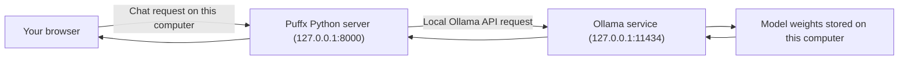

# Puffx Ofline GPT

**Private AI chat running locally on your computer.**

**Powered by Puffx Host · Made with Nitin Mehta.**


**[🌐 Open the Live UI Demo](https://puffxhost.github.io/Puffx-Offline-GPT/)** · Visual preview only; run the app with Ollama locally for real AI chat.

Puffx Ofline GPT is a ChatGPT-inspired interface for chatting with an AI model running on your own computer through [Ollama](https://ollama.com/). It is an independent project and is not affiliated with OpenAI. The name describes the interface; this project does **not** contain ChatGPT, OpenAI models, or model weights.

## What this repository is for

This repository gives you a simple browser-based chat screen and a small local Python server that passes your conversation to Ollama. Install Ollama, download a supported model once, start the app, and chat in your browser. You do not need an OpenAI account, cloud API key, subscription, Node.js, or Python packages.

Use it for local text conversations such as asking questions, explaining topics, brainstorming, drafting text, or getting coding help. The exact quality and speed depend on the model you choose and your computer. The default model is `qwen2.5:3b`; this is a compact text model, not a copy of ChatGPT. The app does not browse the web, generate images, or attach documents.

### How a message travels



The browser saves chat history in that browser profile's local storage. The model is downloaded separately by Ollama. By default, the Python server accepts connections only from this computer; the app is not a hosted website for other devices.

### What is in the repository

| File or folder | Purpose |
| --- | --- |
| `server.py` | Serves the web interface and forwards chat requests to Ollama. Uses only Python's standard library. |
| `static/index.html` | Chat page layout and branding. |
| `static/style.css` | Responsive dark/light interface and motion effects. |
| `static/app.js` | Chat history, status display, theme, and browser interactions. |
| `START_OFFLINEGPT.bat` | Optional Windows launcher that starts the server and opens the local page. |
| `assets/` | Animated README preview graphics. |
| `LICENSE` | MIT license for this project's code. |

## Features

- ChatGPT-inspired dark interface with light theme, prompt suggestions, and a conversation sidebar.
- Runs inference through an Ollama model on your computer; no cloud AI API key is needed.
- Keeps conversation history in your browser's local storage.
- Python web server uses only Python's standard library; no Python packages or build tools are required.
- Binds to `127.0.0.1` by default, so the web app is only available on the same computer.
- Animated interface preview above. The app respects the operating system's reduced-motion preference.

## Requirements

- Windows 10 or newer, macOS, or a supported Linux distribution.
- Python 3.11 or newer.
- Ollama installed and running.
- Internet access for the initial software and model downloads. After downloading the model, chat can run without internet.
- Free disk space for the selected model. The default `qwen2.5:3b` model download is about 1.9 GB. You do not need a GPU, but a compatible GPU can improve speed; CPU-only generation may be slower. Model memory needs and speed depend on your machine.

Model weights are downloaded separately by Ollama. Pick a model that fits your storage and computer; the download size below is **disk space**, not the total RAM needed while it is running. Smaller models are easier to run but can give weaker answers; larger ones need more memory and may be slower. Check each publisher's license before redistributing model weights.

## Available models

Puffx Ofline GPT starts with `qwen2.5:3b`. It can also use any text model that Ollama has downloaded on your computer. These are example choices from the [Ollama model library](https://ollama.com/library):

| Model tag | Approx. download | Suggested use |
| --- | ---: | --- |
| `qwen2.5:0.5b` | 398 MB | Smallest Qwen option for low-storage or low-memory computers; simpler answers. |
| `gemma3:1b` | 806 MB | Small text model when you want an alternative to Qwen. |
| `qwen2.5:1.5b` | 986 MB | A small step up from 0.5B while keeping download size modest. |
| `llama3.2:1b` | 1.3 GB | Compact multilingual model; the model publisher lists Hindi among its supported languages. |
| `qwen2.5:3b` | 1.9 GB | Default balance of size and answer quality. |
| `qwen2.5:7b` | 4.7 GB | Larger Qwen option; requires more storage and computer memory. |

Sizes are approximate and can change when Ollama updates model builds or quantizations. See the [Qwen 2.5](https://ollama.com/library/qwen2.5), [Gemma 3](https://ollama.com/library/gemma3), and [Llama 3.2](https://ollama.com/library/llama3.2) model pages for current tags, details, and license information.

## Quick start

If Git, Python, and Ollama are already installed, clone the public repository, download the model, and start the app:

```bash
git clone https://github.com/puffxhost/Puffx-Offline-GPT.git
cd Puffx-Offline-GPT
ollama pull qwen2.5:3b
python3 server.py
```

On Windows, use `py -3 server.py` instead of `python3 server.py`, or double-click `START_OFFLINEGPT.bat`. Open [http://127.0.0.1:8000](http://127.0.0.1:8000) in a browser on the same computer. The first model download needs internet; later chats use the local model.

> This repository is public, so you can clone it without signing in to GitHub. If you do not use Git, download the ZIP from **Code → Download ZIP**, extract it, and open a terminal in the extracted folder.

## Use the chat screen

1. Start Ollama and the Puffx Python server, then open `http://127.0.0.1:8000` in a browser on the same computer.
2. Check the status pill at the top: **Running locally** means Ollama is reachable and the selected model is downloaded. **Model not downloaded** means Ollama is reachable but needs the configured model tag. **Ollama not running** means start/open Ollama and refresh.
3. Type a question in the bottom message box and press **Enter** to send. Press **Shift+Enter** to add a new line.
4. Use **New chat** to start a separate conversation. Select a conversation in the sidebar to return to it. The theme button switches between dark and light mode.
5. Use **Ctrl+K** on Windows/Linux or **Command+K** on macOS to start a new chat. On a narrow screen, use the menu button to show the sidebar.
6. Choose an installed model from the model dropdown in the top bar. Your selection is remembered in this browser. If a model is missing, download it with `ollama pull MODEL_TAG`, then wait for the model list to refresh (up to 20 seconds) or reload the page.

The browser history belongs to the browser profile on this computer. It does not automatically sync between browsers or computers. If Ollama is not ready when you first open the page, start it and refresh the app.
## Detailed setup

### 1. Get the project

Choose one method. The repository is public, so GitHub login is not required to clone or download it.

**Git (recommended):** install Git if needed, then run these commands in PowerShell, CMD, Terminal, or a Linux shell:

```text
git clone https://github.com/puffxhost/Puffx-Offline-GPT.git
cd Puffx-Offline-GPT
```

**ZIP:** on the repository page, choose **Code → Download ZIP** and extract it. Open PowerShell, CMD, or Terminal in the extracted `Puffx-Offline-GPT` folder before running the commands below. In File Explorer, click the address bar and type `powershell` or `cmd` to open a terminal in that folder.

### 2. Windows 10 or newer

Follow these steps in order. You can use either PowerShell or Command Prompt (CMD); commands for both are shown separately. Run the commands from the project folder unless a step says otherwise.

#### Step 1: Install the prerequisites

Install Python 3.11+ from [python.org](https://www.python.org/downloads/). In the installer, enable **Add Python to PATH** if offered. Install [Ollama for Windows](https://ollama.com/download/windows), then open the Ollama app once so its local service starts. Git is optional if you use the ZIP download instead of cloning.

If `winget` is available, run these commands in PowerShell, Windows Terminal, or CMD. Git is needed only for the Git clone method:

```text
winget install --id Git.Git -e
winget install --id Python.Python.3.12 -e
winget install --id Ollama.Ollama -e
```

Close and reopen the terminal after installation. If `winget` is unavailable, use the official Python and Ollama installer links above. The Ollama PowerShell installer is also available from its official source:

```powershell
irm https://ollama.com/install.ps1 | iex
```

#### Step 2: Download the project

**PowerShell with Git:**

```powershell
git clone https://github.com/puffxhost/Puffx-Offline-GPT.git
Set-Location Puffx-Offline-GPT
```

**CMD with Git:**

```bat
git clone https://github.com/puffxhost/Puffx-Offline-GPT.git
cd /d Puffx-Offline-GPT
```

If you downloaded a ZIP instead, extract it first and open a terminal inside that extracted folder. In File Explorer, open the folder, click the address bar, type `powershell` or `cmd`, and press Enter. If you prefer to navigate manually:

PowerShell:

```powershell
Set-Location "$HOME\Downloads\Puffx-Offline-GPT"
```

CMD:

```bat
cd /d "%USERPROFILE%\Downloads\Puffx-Offline-GPT"
```

Change the example path if you extracted the ZIP somewhere else. Keep the terminal open in this project folder for the remaining steps.

#### Step 3: Confirm the tools are available

PowerShell:

```powershell
git --version
py -3 --version
ollama --version
```

CMD:

```bat
git --version
py -3 --version
ollama --version
```

Python should report version 3.11 or newer. If `py` is not recognized, try `python --version` and use `python server.py` in the later steps. If `ollama` is not recognized, reopen the Ollama app and start a new terminal.

#### Step 4: Start Ollama and download the model

Open the Ollama app from the Windows Start menu and leave it running. In PowerShell or CMD, download the default model:

```text
ollama pull qwen2.5:3b
ollama list
```

Wait for `pull` to finish. Confirm that `ollama list` shows the exact `qwen2.5:3b` tag. The model download needs internet; chatting with the downloaded local model does not. If the PC has limited memory, try the smaller `qwen2.5:1.5b` model instead; see [Choose another model](#choose-another-model).

#### Step 5: Start the Puffx web app

Make sure the terminal is still in the `Puffx-Offline-GPT` project folder.

PowerShell:

```powershell
py -3 server.py
```

CMD:

```bat
py -3 server.py
```

If `py` is not available but `python` works, use `python server.py` in either shell. You can also double-click `START_OFFLINEGPT.bat`; it starts a server window and opens the browser. Keep the server window open while chatting.

When the terminal reports that Puffx Ofline GPT is ready, open [http://127.0.0.1:8000](http://127.0.0.1:8000) in a browser on the same PC. Type a question and press **Enter**; use **Shift+Enter** for a new line. Press **Ctrl+C** in the server terminal to stop the app.

#### Step 6: Optional Windows settings

To select another downloaded model or free up port 8000, follow [Choose another model](#choose-another-model) or [Change the port or Ollama address](#change-the-port-or-ollama-address). In PowerShell, settings use `$env:NAME = 'value'`; in CMD, use `set NAME=value`. Start the server from that same terminal so it receives the setting.
### 3. macOS

#### Install the tools

Install Python 3.11+ from [python.org](https://www.python.org/downloads/macos/), or use Homebrew if it is already installed:

```bash
brew install python git
```

Install Ollama from [ollama.com/download](https://ollama.com/download), open the Ollama app, and install Git if you plan to clone the repository. Check that Terminal can find Python and Ollama:

```bash
python3 --version
git --version
ollama --version
```

#### Download the model and run

In Terminal, clone the repo and download the model:

```bash
git clone https://github.com/puffxhost/Puffx-Offline-GPT.git
cd Puffx-Offline-GPT
ollama pull qwen2.5:3b
python3 server.py
```

If you downloaded a ZIP, `cd` into its extracted folder instead of cloning. Keep Terminal open and visit [http://127.0.0.1:8000](http://127.0.0.1:8000). Stop the server with **Ctrl+C**.

### 4. Linux

#### Install Python and Git

Install Python 3, Git, and curl using your distribution's package manager. On older OS releases, check that `python3 --version` is at least 3.11.

Ubuntu, Debian, and Linux Mint:

```bash
sudo apt update
sudo apt install -y python3 git curl
```

Fedora:

```bash
sudo dnf install -y python3 git curl
```

Arch Linux and Manjaro:

```bash
sudo pacman -Syu --needed python git curl
```

openSUSE:

```bash
sudo zypper install python3 git curl
```

#### Install and start Ollama

Use the official Ollama installer:

```bash
curl -fsSL https://ollama.com/install.sh | sh
```

On systemd systems, check and start the service if necessary:

```bash
systemctl status ollama
sudo systemctl start ollama
```

On systems without systemd, open a separate terminal and run `ollama serve`, leaving that terminal open. Confirm the CLI is available with `ollama --version`.

#### Download the model and run

```bash
git clone https://github.com/puffxhost/Puffx-Offline-GPT.git
cd Puffx-Offline-GPT
ollama pull qwen2.5:3b
python3 server.py
```

For a ZIP download, change into the extracted project folder instead. Keep the app terminal open and visit [http://127.0.0.1:8000](http://127.0.0.1:8000). Stop it with **Ctrl+C**.

## Download, select, and switch models

### 1. Download a model

The first download needs an internet connection. Open PowerShell or Command Prompt on Windows, or Terminal on macOS/Linux, and run **one** `ollama pull` command with the exact model tag:

**Small download for limited storage or memory:**

```text
ollama pull qwen2.5:0.5b
```

**Other small options:**

```text
ollama pull gemma3:1b
ollama pull qwen2.5:1.5b
ollama pull llama3.2:1b
```

**Default model:**

```text
ollama pull qwen2.5:3b
```

**Larger model for a more capable computer:**

```text
ollama pull qwen2.5:7b
```

Do not paste the whole list as one command. Run the command for the model you want, wait until Ollama finishes, then see what is installed:

```text
ollama list
```

The output shows the model names available on this computer. You can download more than one model, but each uses additional disk space. To remove a model and free storage, first switch Puffx to a different model, then run `ollama rm MODEL_TAG` (for example, `ollama rm qwen2.5:0.5b`).

### 2. Switch models in Puffx

1. Start Ollama and the Puffx server as described in setup.
2. In Puffx, open the model dropdown in the top bar beside the green status dot.
3. Choose one of the downloaded models. Puffx updates the composer and workspace labels to show the selected model.
4. Send your next message. The selected model answers it; you do not need to restart the Python server.
5. Puffx remembers the selected model in that browser. Select another entry in the same dropdown any time to switch back.

Only models already downloaded by Ollama appear as usable models. If the status says **Model not downloaded**, run `ollama pull EXACT_MODEL_TAG` in a terminal, wait for it to finish, then reload Puffx or wait up to 20 seconds for the list to refresh. The model tag must match what `ollama list` shows.

### 3. Optional: change the server's fallback model

The model dropdown is the normal way to switch. Advanced users can also set `OLLAMA_MODEL` before starting the server. This sets the fallback model when this browser has not saved a model choice yet.

**PowerShell:**

```powershell
$env:OLLAMA_MODEL = 'qwen2.5:1.5b'
py -3 server.py
```

**Windows Command Prompt (CMD):**

```bat
set OLLAMA_MODEL=qwen2.5:1.5b
py -3 server.py
```

**macOS / Linux:**

```bash
OLLAMA_MODEL=qwen2.5:1.5b python3 server.py
```

Download the matching tag first with `ollama pull qwen2.5:1.5b`. If Puffx has already remembered a different choice in that browser, select the fallback model from the top-bar dropdown or clear the saved `offlinegpt_model` entry in that browser's site storage.

## Run offline

Install Ollama and download the model while you have internet. After that, start Ollama and Puffx Ofline GPT as usual; the chat requests go to Ollama on your computer and do not use a cloud AI service. The app can load without internet, although Google Fonts will fall back to system fonts. No separate API key is required.

## Change the port or Ollama address

The app listens on `127.0.0.1` and port `8000` by default. If port 8000 is already in use, set another port before launching:

**PowerShell:**

```powershell
$env:PORT = '8001'
py -3 server.py
```

**Windows CMD:**

```bat
set PORT=8001
py -3 server.py
```

**macOS / Linux:**

```bash
PORT=8001 python3 server.py
```

Then open `http://127.0.0.1:8001`. To use a different Ollama endpoint, set `OLLAMA_URL` in the same terminal before starting the app. For example, PowerShell: `$env:OLLAMA_URL = 'http://127.0.0.1:11434'`; CMD: `set OLLAMA_URL=http://127.0.0.1:11434`; macOS/Linux: `OLLAMA_URL=http://127.0.0.1:11434 python3 server.py`.

The server binds to loopback by design. Other computers and phones cannot connect to it through your PC's network address.

## Update the project

If you cloned with Git, stop the app with **Ctrl+C**, then run this from the project folder:

```text
git pull
```

Start the app again with the same command. If you use the ZIP method, download and extract the latest ZIP. Keep any local edits you want before replacing the old folder.

## Troubleshooting

| Problem | What to do |
| --- | --- |
| Browser cannot connect to `127.0.0.1:8000` | Start `server.py` first and keep its terminal open. Use the same computer and exact address. If the port is busy, [change the port](#change-the-port-or-ollama-address). |
| “Ollama not running” | Open the Ollama app on Windows/macOS. On Linux, check `systemctl status ollama`; if there is no systemd service, run `ollama serve` in another terminal. Refresh the app. |
| “Model not downloaded” | Run `ollama list` and confirm the exact configured tag. For the default, run `ollama pull qwen2.5:3b`, wait for completion, and refresh. |
| `ollama` command not found | Finish installing Ollama, reopen the Ollama app, then open a fresh terminal and run `ollama --version`. |
| `py` or `python` command not found on Windows | Reinstall Python and enable **Add Python to PATH**. Reopen the terminal. Try `py -3 --version` or `python --version`. |
| `python3` command not found on macOS/Linux | Install Python 3 from the linked installer or your distribution's package manager. Confirm with `python3 --version`. |
| Port 8000 is already in use | Set `PORT` to another value such as `8001` in the server terminal and open the matching URL. |
| Model is slow or the computer runs out of memory | Close other heavy apps, use a smaller model such as `qwen2.5:1.5b`, or use a computer with more memory. Larger models usually need more resources. |
| Fonts look different while offline | Google Fonts need internet. The app falls back to fonts already installed on your computer. |

## Privacy and limitations

- Chat prompts travel from your browser to this computer's Python server and then to Ollama at `127.0.0.1:11434` by default. This app does not send prompts to OpenAI or another cloud AI API.
- Conversation history is stored in local storage in the browser profile you use. Clearing that browser's site data deletes the saved history. This app does not encrypt that history or provide user accounts/passwords; anyone with access to the same browser profile can access it.
- Google Fonts may be requested when internet is available; chat prompts are not sent with those font requests. Offline, system fonts are used.
- Model replies can be inaccurate. Verify important information independently.
- Ollama downloads the model weights separately. Model availability and license terms are controlled by the model publisher.

## 🛟 Support & Contact

Need help or want to report an issue?

- 🌐 Website: [puffxhost.com/contact](https://puffxhost.com/contact)
- 📧 Email: [support@puffxhost.in](mailto:support@puffxhost.in)
- 📞 Call: [+91 8602967573](tel:+918602967573)
- 💬 WhatsApp: [+91 7354336624](https://wa.me/917354336624)
- 📷 Instagram: [@nitinmehta.codes](https://www.instagram.com/nitinmehta.codes/)

## 🙌 Contributing

Contributions are welcome. Fork the repository, make your changes on a branch, and open a pull request with a clear description of what you changed.

## ⭐ Give a Star

If you find Puffx Ofline GPT useful, please consider starring the repository on GitHub. It helps others discover the project and supports its development.

## 🔗 About

Puffx Ofline GPT is a local text-chat interface for an AI model running through Ollama on your computer. Download a compatible model once while online; after setup, you can chat locally without an internet connection. It does not generate images, browse the web, or run ChatGPT/OpenAI models.

## 🧠 Puffx Host

**Puffx Ofline GPT** is developed by **Nitin Mehta** and maintained under the **Puffx Host** brand.

Official site: [puffxhost.com](https://puffxhost.com/) · Support: [puffxhost.com/contact](https://puffxhost.com/contact) · Instagram: [@nitinmehta.codes](https://www.instagram.com/nitinmehta.codes/)

---

Made with ❤️ by **Puffx Host**.

## 📜 License

This project's app code is licensed under the MIT License. See [LICENSE](LICENSE) for full details. Model weights are downloaded separately and follow their own license terms; see [Requirements](#requirements) and [Privacy and limitations](#privacy-and-limitations).

